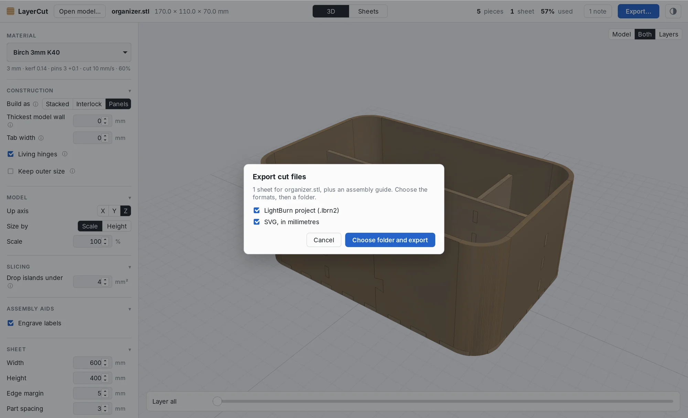

<figure markdown="1">
{width=2000 height=1216 loading=lazy}
<figcaption>Choose the formats, then the folder. LayerCut remembers your choice.</figcaption>
</figure>

## Exporting

Click **Export…** in the top bar, or choose **File → Export Cut Files** (<kbd>⌘E</kbd>). Tick the formats you want, then click **Choose folder and export**. When it's done, LayerCut offers to show the files in Finder or Explorer.

## The files

For a model called `vase`, cut on two sheets:

| File | What it is |
|---|---|
| `vase-sheet01.lbrn2`, `vase-sheet02.lbrn2` | LightBurn projects, one per sheet |
| `vase-sheet01.svg`, `vase-sheet02.svg` | SVG files, one per sheet |
| `vase-assembly.txt` | The [assembly guide](/docs/assembly/) |

## LightBurn projects (.lbrn2)

Open them with **File → Open** in LightBurn, or drag them onto LightBurn.

- Coordinates are stored in **millimeters**, so there's no DPI setting to get wrong.
- Engraving and scoring are on layer **C01** (blue), which **runs first** so the sheet doesn't shift before the labels are done.
- Cuts are on layer **C02** (red).
- Each layer's speed, power and passes come from your [material](/docs/materials/).

> The laser settings in a new material are only starting values. Check them for your machine, lens and sheet before cutting.

LightBurn exports need LayerCut Pro once version 1.0 is released. During the beta they're unlocked.

## SVG

Every edition exports SVG. The files declare their size in millimeters, with a matching millimeter view box, so they import at true size in LightBurn, Inkscape, Illustrator, xTool Creative Space and Glowforge, whatever the program's DPI setting.

The colors follow the usual convention: **red** (`#FF0000`) to cut and **blue** (`#0000FF`) to engrave or score. In most laser software you assign a layer to each color once, then reuse it.

## Before you cut

1. Check the sheet size in LightBurn matches your stock.
2. Run a frame to check the job fits on the material.
3. Cut the first sheet and check a slot or pin fit before cutting the rest.
