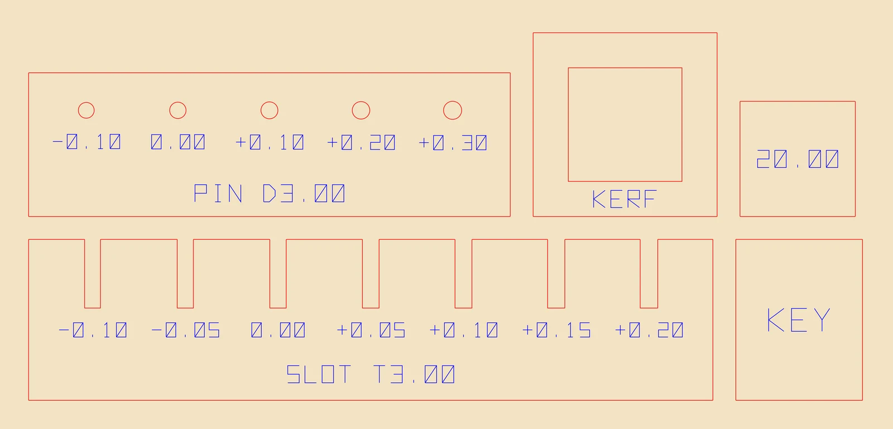

<figure markdown="1">
{width=1600 height=769 loading=lazy}
<figcaption>The 156 × 75 mm fit test: kerf square and frame, slot comb and key, and pin plate. Every gap is engraved with the value to enter.</figcaption>
</figure>

## Cutting it

Choose **Material → Cut a Fit Test…**, or click **Cut a fit test…** in the Materials panel. LayerCut writes the test as LightBurn and SVG files, with a text file of instructions alongside.

Cut it with the **same sheet, power and speed** you'll use for the real job. Every piece is kerf-compensated exactly as a real model would be.

## 1. Kerf (do this first)

Measure the 20 mm square edge to edge with calipers, then work out your true kerf:

> true kerf = current kerf + (20.00 − measured size)

For example, with a kerf of 0.14 mm, a square measuring 19.92 mm gives 0.14 + 0.08 = **0.22 mm**. Enter that as **Kerf** in the material. The square should also drop into the frame marked KERF with a snug fit.

If you changed the kerf, cut the test again before step 2, because the slots and holes depend on it.

## 2. Slot clearance (interlocking and panels)

Push the KEY strip into each slot of the comb. The slots run from −0.10 to +0.20 mm, in 0.05 mm steps, and each is engraved with its value. Choose the one that fits the way you want:

- **hand-tight**, to hold without glue
- **slightly looser**, if you'll glue the piece

Enter that number as **Slot clearance**.

## 3. Pin hole clearance (stacked)

Try your dowel in each hole of the PIN plate: −0.10, 0.00, +0.10, +0.20 and +0.30 mm. Enter the best one as **Hole clearance**.

## 4. Save the material

Click **Save** in the Materials panel. Every export from now on uses these values.
