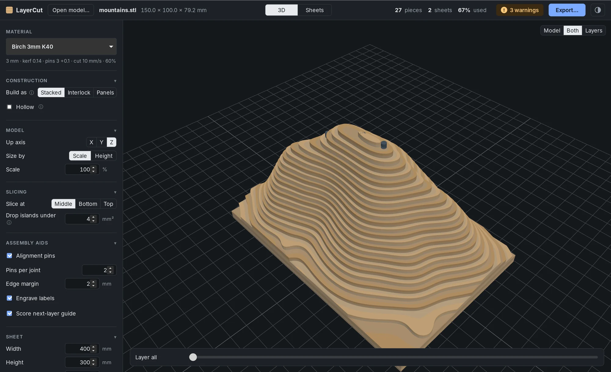

LayerCut takes a 3D model and works out how to build it from flat sheets on a laser cutter. You choose the material and the way the piece goes together. LayerCut then cuts the model into pieces, adds the slots, joints, pin holes and labels, packs the pieces onto sheets, and exports files your laser software can run.

<figure markdown="1">
{width=2000 height=1216 loading=lazy}
<figcaption>Settings on the left, the 3D preview on the right, and the result summary in the top bar.</figcaption>
</figure>

## Start here

<ul class="docs-home-list">
<li><a href="/docs/getting-started/">Install and first cut</a>
Download, install and take a model all the way to a cut file.
</li>
<li><a href="/docs/the-window/">The LayerCut window</a>
The settings, the 3D and Sheets views, and the top bar.
</li>
<li><a href="/docs/materials/">Materials</a>
Save thickness, kerf, clearances and laser settings for each sheet you use.
</li>
<li><a href="/docs/fit-test/">The fit test</a>
One small cut that tells you your real kerf and the best slot and pin fits.
</li>
</ul>

## Ways to build

<ul class="docs-home-list">
<li><a href="/docs/stacked/">Stacked</a>
Layers glued flat, with alignment pins, guides and optional hollowing.
</li>
<li><a href="/docs/interlocking/">Interlocking: grid</a>
Two sets of crossing slices that slot together like an egg crate.
</li>
<li><a href="/docs/radial/">Interlocking: radial</a>
Spokes and rings for round shapes, solid or as an open shell.
</li>
<li><a href="/docs/panels/">Panels</a>
Thin-walled boxes and organizers as flat panels with finger joints and slots.
</li>
<li><a href="/docs/living-hinges/">Living hinges</a>
Rounded corners cut as one bendable strip.
</li>
</ul>

## Cut and build

<ul class="docs-home-list">
<li><a href="/docs/sheets-and-nesting/">Sheets and nesting</a>
How pieces are packed, and how to read the Sheets view.
</li>
<li><a href="/docs/exporting/">Export and LightBurn</a>
The files LayerCut writes and how to open them in LightBurn.
</li>
<li><a href="/docs/assembly/">Assembling your piece</a>
Using the assembly guide, labels, pins and joints.
</li>
<li><a href="/docs/warnings/">Warnings and notes</a>
What each message means and what to change.
</li>
</ul>
