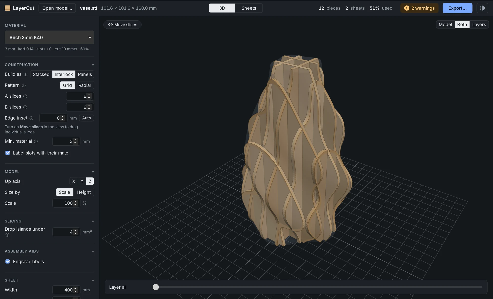

<figure markdown="1">
{width=2000 height=1216 loading=lazy}
<figcaption>A 160 mm vase as a 6 × 6 grid of slices.</figcaption>
</figure>

## How it works

Choose **Interlock** under **Construction**, with **Pattern** set to **Grid**.

LayerCut takes two sets of vertical slices at right angles to each other. The **A slices** stand upright with slots opening from the top. The **B slices** drop onto them with slots opening from the bottom. Wherever two slices cross, the shared height is split at its midpoint, so each slot goes halfway.

Slot width is the material's measured thickness plus its **slot clearance**, then kerf-compensated, so the fit matches your [fit test](/docs/fit-test/).

## Settings

| Setting | Default | What it does |
|---|---|---|
| A slices | 6 | Number of upright slices, with slots on top. |
| B slices | 6 | Number of crossing slices, with slots underneath. |
| Edge inset | 0 mm | How far the first and last slices sit from the model's edges. 0 spaces them evenly. |
| Auto | | Tries a range of edge insets and picks the one with the fewest weak spots. |
| Min. material | 3 mm | Warns when a slot leaves less than this beside it. |
| Label slots with their mate | On | Engraves the name of the crossing slice beside each slot. |

## Moving single slices

Turn on **Move slices** in the 3D view and drag any slice along its axis, in 0.5 mm steps, or 0.1 mm with <kbd>Shift</kbd>. Moved slices are listed in the sidebar with a **Reset** link, and they keep their place when you change the model's size.

Move a slice to catch a feature, such as a nose or an ear, or to move a slot away from a thin edge.

## Checks before you cut

LayerCut flags crossings that won't work, with the slice names, so you can fix them before cutting:

- **Overhangs**: where the shape overhangs, two slices can't slide together, so no slot is cut there.
- **Thin material**: a slot that leaves less than **Min. material** above, below or beside it may snap.
- **Thin strips at edges**: a slot near the edge of a slice leaves a fragile strip. Use **Edge inset** or **Auto**, or drag that slice inward.
- **Split slices**: slots that cut a slice into separate parts. The parts are labeled .1, .2 and so on, and only stay in place once assembled.
- **Crowding**: slices so close together that they're hard to assemble.

## Tips

- Round shapes such as pots often have thin strips beside their outermost slots. **Auto** inset usually fixes this.
- More slices give a better silhouette, but more slots and a stiffer fit. Start with 5–8 each way.
- Cut a fit test for your material first. A slot that's 0.1 mm too tight won't go together; one that's too loose rattles.
