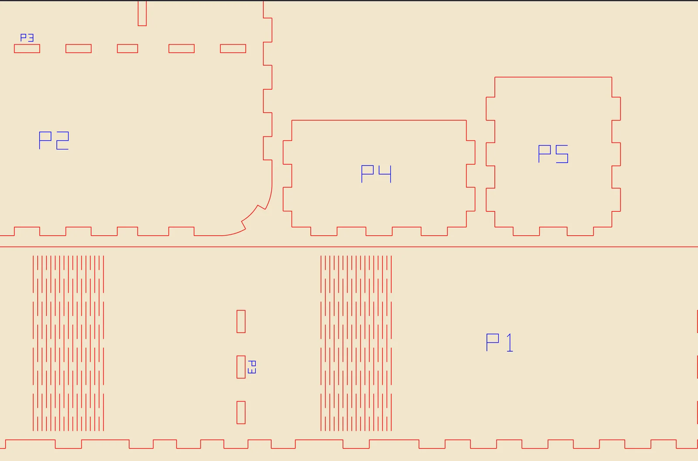

<figure markdown="1">
{width=1600 height=1058 loading=lazy}
<figcaption>Each band of slits is one rounded corner. The flat walls either side stay solid.</figcaption>
</figure>

> Exporting living hinges needs LayerCut Pro once version 1.0 is released. During the beta, everything is unlocked.

## When LayerCut makes a hinge

In [Panels](/docs/panels/) mode, with **Living hinges** on, LayerCut looks for walls that curve: both faces are cylindrical, and they run smoothly into flat walls at each end. Faceted curves, where a cylinder was saved as flat strips, are recognized too.

That stretch of wall, plus the flat walls on either side, is unrolled into one long strip. Staggered rows of slits are cut across each curve, so the strip bends there.

Curves tighter than **three times the material thickness**, such as small fillets, stay as ordinary corners with finger joints. LayerCut tells you when it skipped a curve for being too tight.

## How the rest fits around it

- **The base** gets finger joints that follow the curve, so the strip's tabs drop into the base all the way round.
- **Dividers** meeting the curved strip go into slots in the strip.
- **Shelves** crossing a curved wall partway up aren't joined to it. LayerCut tells you to glue those.

## Walls that go all the way round

A wall that curves all the way round, such as a box with four rounded corners or a round cup, has no ends. LayerCut opens it at a **seam**: a flat stretch clear of dividers, or a point between panels that meet a cylinder. The two ends lock together with **dovetail keys**.

## Bending the strip

1. Bend the strip gently and evenly over your hand or a round former before fitting it. It bends either way.
2. Fit the strip's tabs into the base, starting at one end and working round.
3. For a closed wall, push the dovetail keys together last.

> Thin birch plywood, 3 mm or less, bends best. MDF bends too but snaps more easily. Acrylic doesn't bend cold: heat it, or choose a different build.
