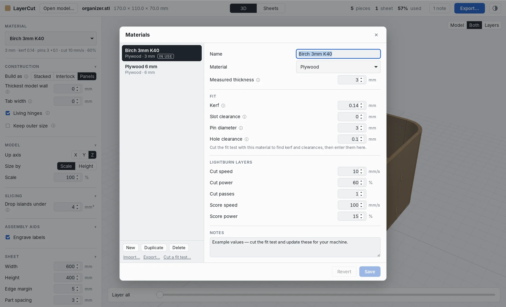

<figure markdown="1">
{width=2000 height=1216 loading=lazy}
<figcaption>Material → Manage Materials… lists your materials on the left and the selected one's values on the right.</figcaption>
</figure>

## Why materials matter

Plywood sold as “3 mm” is often 2.8 or 3.2 mm, and every laser burns away a slightly different amount. LayerCut keeps these values in a named material, such as “Birch 3 mm on the K40”, rather than in each job. Pick the material, and every slot, pin hole and outline is sized for it.

## What a material holds

| Value | What it does |
|---|---|
| Name | How it appears in the material list and in exported file names. |
| Material | The type, such as plywood, MDF or acrylic, for your reference. |
| Measured thickness | The real thickness of your sheet, measured with calipers. Sets the layer height and the slot widths. |
| Kerf | The width of material the laser burns away. Outlines grow and holes shrink by half of it. |
| Slot clearance | Extra width added to interlocking slots and panel slots. Negative values make a tighter fit. |
| Pin diameter | The dowel or pin you'll use for stacked alignment. |
| Hole clearance | Extra size for pin holes. |
| Cut speed, power and passes | Written into the LightBurn cut layer. |
| Score speed and power | Written into the LightBurn engrave layer. |
| Notes | Anything you want to remember: supplier, lens, air assist. |

Use the [fit test](/docs/fit-test/) to find the kerf and clearances, rather than guessing.

## Choosing a material

Pick it at the top of the settings, or from the **Material** menu. The line under the menu sums up its key values, so you can check them at a glance.

## Managing materials

Choose **Material → Manage Materials…** (<kbd>⇧⌘M</kbd>). From there you can:

- **New** creates a material with a suggested name and typical kerf ranges. **Material → New Material…** (<kbd>⇧⌘N</kbd>) does the same.
- **Duplicate** copies the selected material, for example to make “Birch 3 mm, slow” from “Birch 3 mm”.
- **Delete** removes a material. You always keep at least one.
- **Import…** and **Export…** move materials between computers or share them with a friend.
- **Cut a fit test…** makes a fit test for the selected material.

Changes are saved when you click **Save**; **Revert** throws them away.

Materials are stored on your computer and shared with the command-line tool:

- Mac: `~/Library/Application Support/app.layercut.desktop/profiles.json`
- Windows: `%APPDATA%\app.layercut.desktop\profiles.json`

> Measure every new batch of sheets. Thickness can change from one stack of plywood to the next, even from the same supplier.
