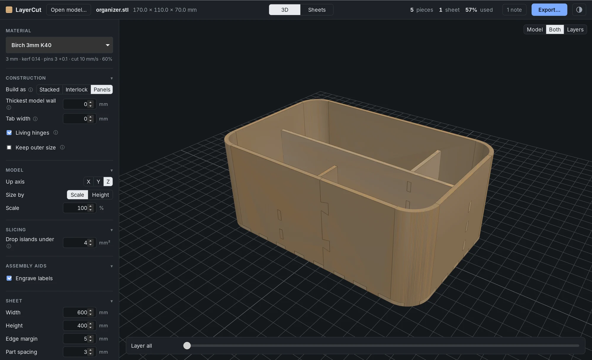

<figure markdown="1">
{width=2000 height=1216 loading=lazy}
<figcaption>A 170 × 110 mm organizer: a base, a wall strip with four living hinges, and three dividers.</figcaption>
</figure>

> Exporting panels needs LayerCut Pro once version 1.0 is released. The free edition shows panels in the 3D and Sheets views so you can try them first. During the beta, everything is unlocked.

## What makes a good panels model

Panels mode looks for **walls**: pairs of flat, parallel faces facing away from each other, close together for their size. Boxes, trays, organizers, shelves and enclosures designed with thin walls work well. Solid shapes have no walls; use [Stacked](/docs/stacked/) or [Interlocking](/docs/interlocking/) for those.

Each wall becomes a panel cut to the wall's outline, including stepped heights, scoops and cut-outs. The panel sits on the wall's center plane and is as thick as your material, which doesn't need to match the model's wall thickness. Small gaps from fillets and joining walls are closed, and panel edges are stretched to meet their neighbours.

## Settings

| Setting | Default | What it does |
|---|---|---|
| Thickest model wall | 0 (automatic) | 0 turns any part that's thin for its size into a panel. Set a limit, measured on the model as designed, only to leave thicker parts out. This isn't your sheet thickness, which comes from the material. |
| Tab width | 0 (automatic) | Width of tabs and corner fingers. 0 uses three times the material thickness. |
| Living hinges | On | Cuts walls that curve round a corner as one strip that bends. See [Living hinges](/docs/living-hinges/). Off leaves curved walls out. |
| Keep outer size | Off | Puts outside walls flush with the model's outside, so the finished piece is exactly the model's size. |

## Joints

LayerCut picks the joint for each place two panels meet:

| Where panels meet | Joint |
|---|---|
| A panel ends against one that carries on, such as a divider on the base or a wall | **Tabs** through engraved, labeled **slots** |
| Two panels end at an outside corner | **Finger joints** |
| Two panels cross, such as two dividers | **Half-lap slots**, each cut halfway |
| Three panels meet at a corner | One panel owns the corner, so there's no hole or overlap |
| Panels meet at an angle other than 90°, such as a ramp or a sloped ledge | **Tab-and-slot** with widened slots. At an angled corner, the bigger panel runs on past the joint to hold the slots. |

Each row of slots is engraved with the name of the panel whose tabs go into it, so you know what goes where.

## Keep outer size

By default every panel is centered on the model's wall. If your sheet is thicker than the model's walls, the finished piece comes out slightly bigger than the model.

Turn on **Keep outer size** when the outside dimensions matter, for example for a box that has to fit a drawer. Outside walls then sit flush with the model's outside, and the inside gets slightly smaller instead.

## Messages you may see

- **Thick parts left out**: parts thicker than the wall limit aren't panels. Raise **Thickest model wall** to include them.
- **Surface not covered**: a share of the model, such as curves too tight for a hinge, fillets or thick blocks, isn't flat walls and was left out.
- **Shallow angles**: panels meeting at a very shallow angle can't be jointed; glue them.
- **Split panels**: joints that cut a panel into separate pieces. Check those panels.

See [Warnings and notes](/docs/warnings/) for the full list.

## Tips

- Design models with walls about the thickness of your sheet, and LayerCut's panels will match your design closely.
- Rounded corners with a radius of at least three times your material thickness become [living hinges](/docs/living-hinges/). Tighter ones are treated as ordinary corners.
- Panels go together without glue if the [fit test](/docs/fit-test/) slot clearance is right. Add wood glue for a permanent piece.
