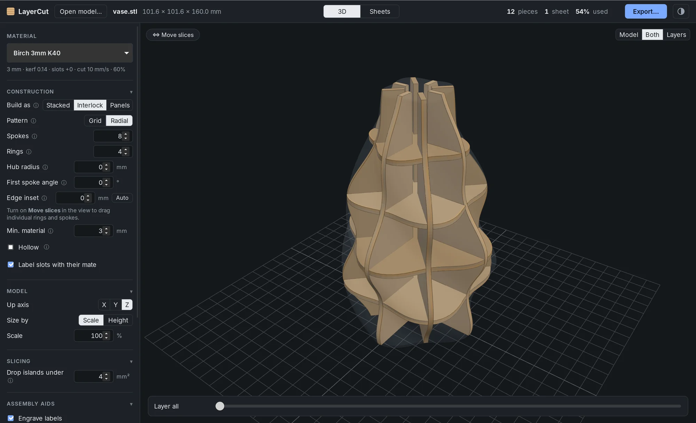
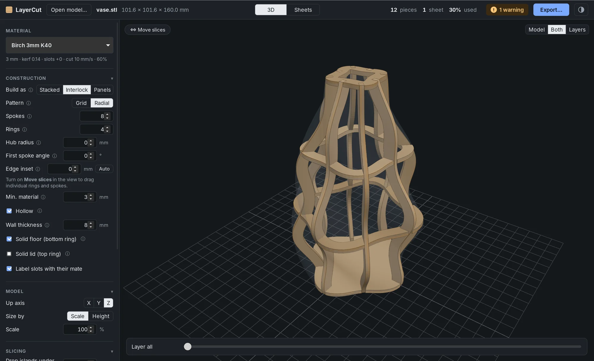

<figure markdown="1">
{width=2000 height=1216 loading=lazy}
<figcaption>Eight spokes and four rings, with a hub at the center.</figcaption>
</figure>

## How it works

Choose **Interlock** under **Construction**, then set **Pattern** to **Radial**.

Spokes S1, S2 and so on are vertical slices through the model's center, spaced evenly around it. Rings R1, R2 and so on are horizontal slices. Each ring is slotted from its rim inward to the middle of the shared material, and each spoke is slotted from its hub edge. To assemble, hold the rings level and slide every spoke straight in towards the center.

## Settings

| Setting | Default | What it does |
|---|---|---|
| Spokes | 8 | Number of upright fins around the center. |
| Rings | 4 | Number of horizontal slices holding the spokes. |
| Hub radius | 0 (auto) | Open space at the center where the spokes start. 0 picks a radius that leaves at least a material thickness of air between neighbouring spokes. |
| First spoke angle | 0° | Turns all the spokes, for example to line one up with a handle or a face. |
| Edge inset | 0 mm | How far the lowest and highest rings sit from the bottom and top. **Auto** picks the inset with the fewest weak spots. |
| Min. material | 3 mm | Warns when a slot leaves less than this beside it. |
| Hollow | Off | Turns the piece into an open shell. See below. |
| Label slots with their mate | On | Engraves the mating piece's name beside each slot. |

With **Move slices** on, drag rings up and down and spokes around the center in the 3D view: 0.5 mm or 0.5° steps, 0.1 with <kbd>Shift</kbd>.

## Hollow shells

<figure markdown="1">
{width=2000 height=1216 loading=lazy}
<figcaption>Hollow on: thin ribs inside the wall, held by narrow bands, with a solid floor.</figcaption>
</figure>

With **Hollow** on, rings become bands as wide as the **Wall thickness**, and spokes become thin ribs that only run through the wall. The result is an open, lightweight shell, like a lantern or lamp shade.

| Setting | Default | What it does |
|---|---|---|
| Wall thickness | 8 mm | Width of the bands and ribs. Keep it at least twice **Min. material**, since slots go halfway into the wall. |
| Solid floor (bottom ring) | On | Keeps the lowest ring a solid disc at the base, so the shell has a bottom. |
| Solid lid (top ring) | Off | Keeps the highest ring a solid disc at the top. Leave off for an open vase. |

The end rings move to the base and rim so they brace the ribs, and the floor and lid slots run out through the ends of the ribs.

## Checks before you cut

The same checks as the grid apply: overhangs, thin material, thin strips, split pieces. Radial adds:

- **Crowded spokes**: spokes too close together at the hub. Use a larger hub or fewer spokes.
- **Overlapping rings**: rings too close to each other. Move them apart or use fewer.

## Tips

- Radial works best on models that are roughly round and centered on their footprint.
- Use an even number of spokes for symmetric shapes, and turn **First spoke angle** to line spokes up with features.
- For lamps, use Hollow with **Solid floor** off and fit a light fitting through the bottom ring.
