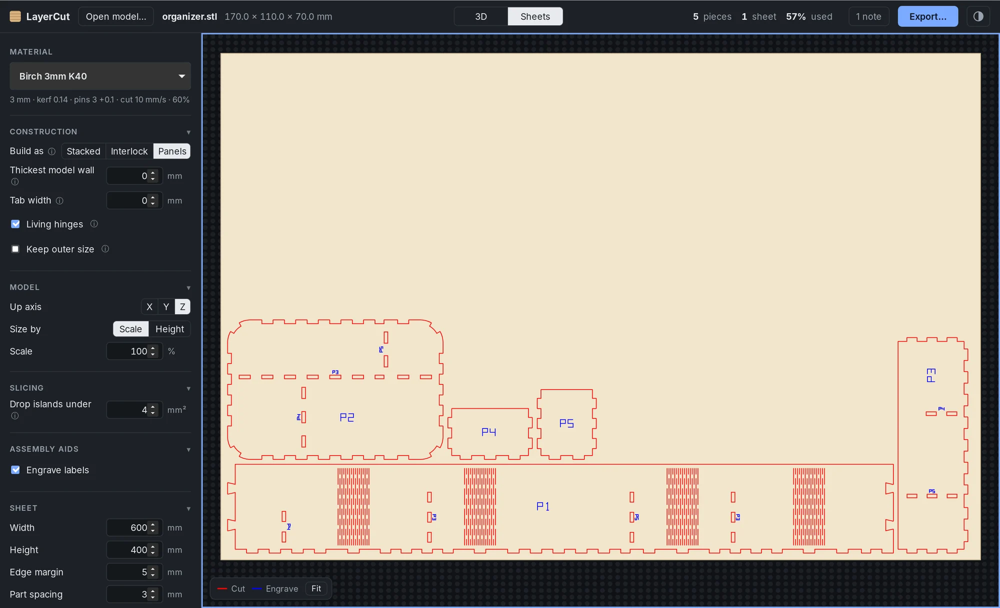

<figure markdown="1">
{width=2000 height=1216 loading=lazy}
<figcaption>The organizer's five panels on one 600 × 400 mm sheet.</figcaption>
</figure>

## Sheet settings

| Setting | Default | What it does |
|---|---|---|
| Width and Height | 400 × 300 mm | The size of the sheets you cut, or your laser bed's working area if that's smaller. |
| Edge margin | 5 mm | Space kept clear around the sheet's edges. |
| Part spacing | 3 mm | The smallest gap between two pieces. |
| Allow rotation | On | Lets pieces turn by 90° to fit better. |

## How nesting works

- Pieces are packed by their **real outlines**, not their bounding boxes, so curved pieces sit close together.
- **Small pieces nest inside the holes** of bigger ones, such as the centers of hollow rings.
- Several packing orders are compared, and the one with the fewest sheets wins.
- Spacing and margins are never less than your settings.
- A piece nested inside another piece's hole is **cut before that hole**, so it doesn't drop out of position first.
- A piece bigger than the sheet isn't squeezed or dropped silently: LayerCut tells you which piece it is, so you can reduce the scale or use a larger sheet.

The top bar shows how many sheets you need and the share of material used. Click it for the size of the strip left over on the last sheet, which you can keep for small jobs.

## Reading the Sheets view

| Line | Meaning |
|---|---|
| Red | Cut all the way through. |
| Blue | Engraved or scored: labels, slot names and guide lines. |

Hover over a piece to see its name. Click it to see where it goes in the 3D model. See [The LayerCut window](/docs/the-window/) for zooming and moving between sheets.
