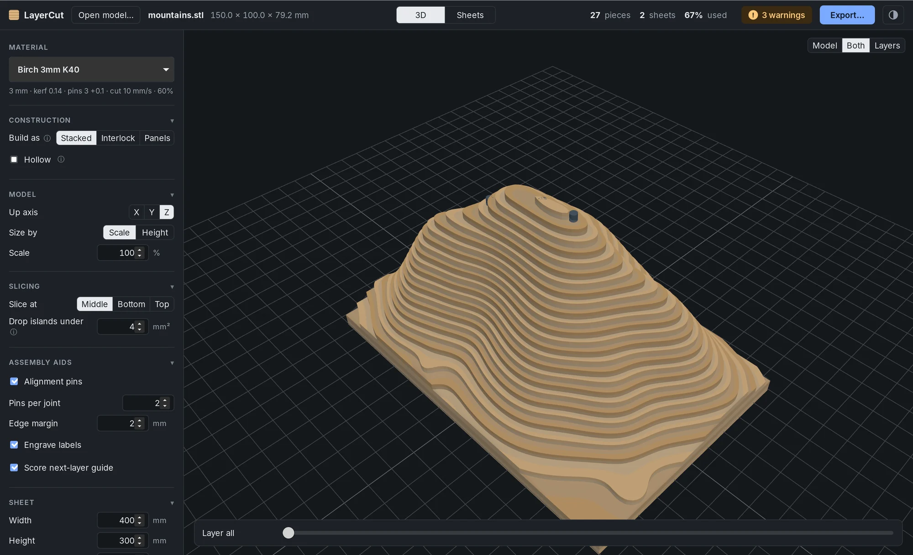

<figure markdown="1">
{width=2000 height=1216 loading=lazy}
<figcaption>A 150 × 100 mm terrain model in 3 mm birch: 27 layers, three alignment pins.</figcaption>
</figure>

## How it works

LayerCut slices the model into horizontal layers, each as thick as your material. Every outline is kerf-compensated: holes and islands inside a layer are found automatically, and a hole that would close up completely is left out. Each piece becomes its own part on the cut sheet.

The number of layers is the model's height divided by the material thickness. Thinner material means more layers and a smoother surface, but more cutting and gluing.

## Settings

| Setting | Default | What it does |
|---|---|---|
| Hollow | Off | Turns each layer into a ring with walls of a set thickness. |
| Wall thickness | 8 mm | How thick the walls of hollow layers are, measured in from the outline. |
| Solid bottom layers | 2 | Layers kept solid at the bottom, such as the floor of a pot. |
| Solid top layers | 0 | Layers kept solid at the top, as a lid. Use 0 for an open pot. |

The Slicing, Assembly aids and Sheet settings also apply. See [Model, size and slicing](/docs/model-and-scale/).

## Hollow layers

Hollowing saves material and weight. Parts of a layer thinner than two walls stay solid, so narrow features keep their strength. On tapered shapes, the smaller rings nest inside the bigger ones on the sheet: a 200 mm sphere goes from 22 sheets to 17. Straight-sided shapes save less material but leave reusable discs from the centers.

If you use alignment pins, make the walls thick enough to hold the pin holes with a margin either side. LayerCut warns when they aren't.

## Alignment pins

With **Alignment pins** on, LayerCut drills dowel holes through the layers so the stack lines up while the glue sets.

- Holes go where every pair of neighbouring layers can share them, spread apart so the stack can't twist.
- Each pin runs through as many layers as it can. The [assembly guide](/docs/assembly/) lists every pin and the length to cut it.
- **Pins per joint** (default 2) sets how many pins join each pair of layers.
- **Edge margin** (default 2 mm) keeps holes away from the outline.
- The pin size comes from the material: **Pin diameter** plus **Hole clearance**.

Where two layers don't overlap enough for a pin, LayerCut says so, and you can line those up by the guide lines instead.

## Labels and guide lines

- **Engrave labels** engraves each piece's layer number in its roomiest spot, away from holes and guide lines, in a single-stroke font that engraves quickly. Islands in the same layer get letters: 12A, 12B.
- **Score next-layer guide** engraves the outline of the layer above onto each piece, so you can see exactly where the next one goes.

## Tips

- For busts and organic shapes, slice at **Middle** and use 3 mm or thinner material.
- For terrain, a thicker base layer makes the piece sturdy: set **Solid bottom layers** with Hollow on, or simply leave Hollow off.
- Glue in order from layer 1, using the pins and guide lines. Clamp lightly; too much pressure squeezes the layers sideways.
