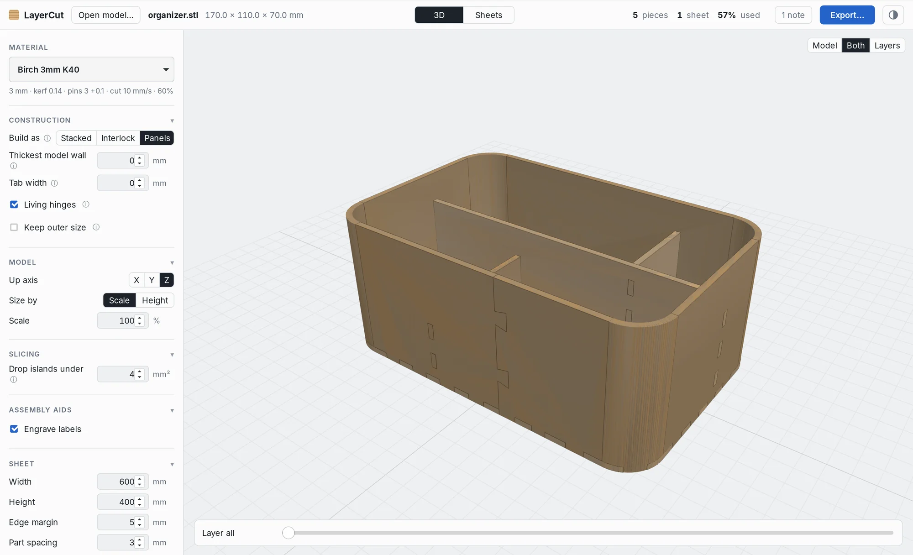
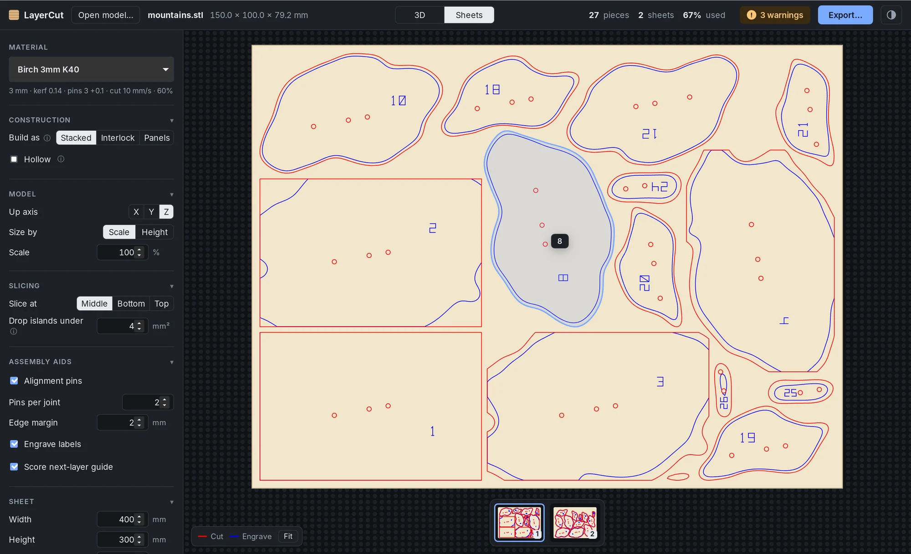

<figure markdown="1">
{width=2000 height=1216 loading=lazy}
<figcaption>The window in light mode, with a desk organizer in the 3D view.</figcaption>
</figure>

## The top bar

From left to right:

- **Open model…** opens an STL or OBJ file. The model's name and size sit next to it. If the mesh has holes, the number of open edges is shown here too.
- **3D** and **Sheets** switch the main view (<kbd>⌘1</kbd> and <kbd>⌘2</kbd>).
- **The result summary**: pieces, sheets and the share of material used. Click it for details such as stack height, footprint, and what's left over on the last sheet.
- **Warnings and notes**: a badge appears when LayerCut has something to tell you. Click it to read the messages. See [Warnings and notes](/docs/warnings/).
- **Export…** writes the cut files (<kbd>⌘E</kbd>).
- **Appearance** (the half-filled circle): light, dark or follow the system, and the accent color.

## The settings

The sidebar is split into sections. Click a section's name to fold it away; LayerCut remembers which are open. Settings with an ⓘ show a short explanation when you hover over it.

| Section | What it holds |
|---|---|
| Material | The material you're cutting. Its values are summed up underneath. |
| Construction | How the model is built, and that mode's settings. |
| Model | Up axis, and size by scale or height. |
| Slicing | Where in each layer to slice, and the smallest island to keep. |
| Assembly aids | Alignment pins, engraved labels and guide lines. |
| Sheet | Sheet size, edge margin, spacing between parts, and rotation. |

Every change re-slices the model straight away. Large models can take a second or two; *Updating…* shows while it works.

## The 3D view

Drag to orbit, scroll or pinch to zoom, and right-drag to pan. The buttons in the top right choose what's shown:

- **Model**: just your original model.
- **Both**: the cut pieces with a faint outline of the model, to compare them.
- **Layers**: just the cut pieces.

In Stacked mode, the **Layer** slider along the bottom builds the piece up one layer at a time, as you will when you glue it.

In Interlocking mode, **Move slices** lets you drag a single slice along its axis in the 3D view, in 0.5 mm steps, or 0.1 mm with <kbd>Shift</kbd>. Moved slices are listed in the sidebar with a **Reset** link.

## The Sheets view

<figure markdown="1">
{width=2000 height=1216 loading=lazy}
<figcaption>Hover a piece to see its name. Click it to find it in the 3D view.</figcaption>
</figure>

Each sheet is shown full size on a laser bed, in the colors LightBurn uses: red lines are cut, blue lines are engraved.

- Scroll or pinch to zoom, and drag to move around.
- **Fit** (<kbd>⌘0</kbd>) shows the whole sheet again.
- When there's more than one sheet, thumbnails along the bottom switch between them. <kbd>←</kbd> and <kbd>→</kbd> do the same.
- Click a piece to jump to the 3D view with that piece highlighted. <kbd>Esc</kbd> clears the highlight.

## Appearance

Click the half-filled circle in the top bar, or choose **View → Appearance…**. Pick **System**, **Light** or **Dark**, and one of six accent colors: blue, green, teal, violet, graphite or orange. <kbd>⇧⌘L</kbd> switches between light and dark.
